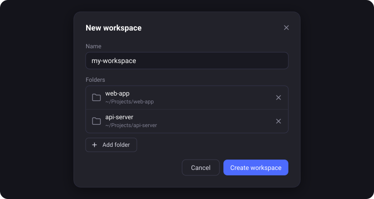
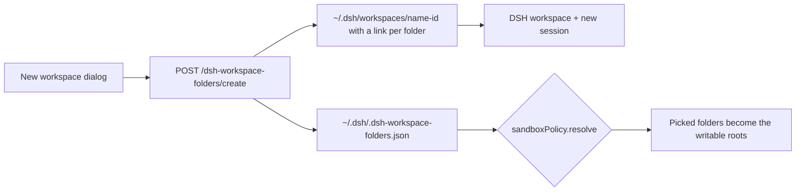

<div align="center">

# dsh-workspace-folders

**Pick several folders. Get one workspace where the agent can work in all of them.**

Multi-folder workspaces for DeepSeek Harness. Choose a few projects anywhere on
disk, give the workspace a name, and every new session in it can read and write
all of those folders. Your projects stay where they are; nothing is copied.



[](LICENSE)
[](#development)
[](#development)

[Quick start](#quick-start) · [Usage](#usage) · [How it works](#how-it-works) · [Configuration](#configuration) · [Privacy](#privacy) · [Troubleshooting](#troubleshooting) · [Development](#development)

</div>

---

## Highlights

- 🗂️ **Always a new workspace** — creating one never reuses, renames, or edits
  an existing workspace, even if a picked folder already has its own.
- ✍️ **Writable everywhere you picked** — `write`, `edit`, `apply_patch` and
  `bash` can change every picked folder; the rest of the disk stays confined
  exactly as before.
- 🧩 **Native UI** — a button in the sidebar footer, a **Workspace folders...**
  item in the workspace menu, and dialogs built from the app's own `Modal`,
  `Button` and `Input` components.
- 🧹 **No leftovers in Ungrouped** — deleting a workspace archives its sessions
  first, so nothing is left orphaned in the sidebar.
- 📁 **Nothing in your projects** — no files, links, or manifests are written
  into the folders you pick.
- ⚙️ **Live** — adding or removing a folder takes effect on the agent's next
  tool call; no restart, no new session.
- 📦 **Zero dependencies** — no install scripts, no native modules, no
  `npm install`.

## Quick start

```sh
dsh plugin --profile desktop add "link:/abs/path/to/dsh-workspace-folders"
```

Restart DeepSeek Harness once (the host half mounts at startup). A folder button
appears in the sidebar footer, next to Settings.

Install straight from GitHub:

```sh
dsh plugin --profile desktop add "github:waldemarpng/dsh-workspace-folders"
```

Pin an exact revision by appending a git ref (`#<tag>` or `#<commit>`). For local
development, clone the repository and use the `link:` form above.

## Usage

| Action | Where |
|---|---|
| Create a workspace | Sidebar footer → folder button → name it, **Add folder** for each project, **Create workspace**. The name defaults to the first folder. |
| Add or remove folders | Right-click a workspace → **Workspace folders...** |
| Delete a workspace | **Workspace folders...** → **Delete workspace**, or the sidebar's own Delete. Sessions are archived, folders on disk are not touched. |
| Clean up old leftovers | Create dialog → **Unused workspaces** → **Clean up**. |

Archived sessions stay recoverable: **View options → All conversations** in the
sidebar.

## How it works



- DSH allows exactly one workspace per directory. To make every workspace new,
  the **host half** creates a small internal root in
  `~/.dsh/workspaces/<name>-<id>` that holds only links to the picked folders,
  and the **client half** registers it as a regular DSH workspace.
- On every tool call the host wraps `ctx.sandboxPolicy.resolve`: for a session
  in a tracked workspace, the first picked folder becomes the writable
  workspace root and the rest become `additionalWritableRoots`. The internal
  root itself stays read-only. The model sees the same set in its standard
  sandbox-policy context, plus one line naming the folders.
- The **Workspace folders...** item also works on ordinary workspaces: there the
  picked folders are added as extra writable roots by absolute path.
- If the host cannot wrap `ctx.sandboxPolicy`, the dialog says so instead of
  silently creating a workspace whose extra folders are not writable.
- The client hooks workspace deletion: sessions are archived first, then DSH
  removes the registration, then the plugin removes its internal root.

## Configuration

State lives in `~/.dsh/.dsh-workspace-folders.json` (or `$DSH_HOME/…`), written
by the dialogs (atomic write, mode 0600).

```json
{
  "version": 1,
  "workspaces": {
    "/Users/you/.dsh/workspaces/my-workspace-3f2a1c": {
      "title": "my-workspace",
      "anchored": true,
      "members": [
        { "name": "web-app", "path": "/Users/you/Projects/web-app" },
        { "name": "api-server", "path": "/Users/you/Projects/api-server" }
      ]
    }
  }
}
```

| Variable | Meaning |
|---|---|
| `DSH_HOME` | Base for the store and internal roots (default `~/.dsh`). |
| `DSH_WORKSPACE_FOLDERS_CONFIG` | Store file path. |
| `DSH_WORKSPACE_FOLDERS_ROOT` | Directory for internal workspace roots. |

A broken store never crashes the host: the plugin refuses to overwrite it, the
state route reports the error, and the sandbox behaves like stock DSH.

## Routes

| Route | Method | Purpose |
|---|---|---|
| `/dsh-workspace-folders/state` | GET | Tracked workspaces, missing folders, sandbox support and why it is off. |
| `/dsh-workspace-folders/roots?cwd=...` | GET | Effective writable roots for a directory, as the sandbox applies them. |
| `/dsh-workspace-folders/create` | POST | Create a new workspace from `folders` and an optional `title`. |
| `/dsh-workspace-folders/attach` | POST | Add folders to a workspace. |
| `/dsh-workspace-folders/detach` | POST | Remove folders from a workspace. |
| `/dsh-workspace-folders/destroy` | POST | Drop the record and the internal root; projects stay. |

Local routes are fenced: cross-site requests, opaque `null` origins, and
origin/host mismatches are rejected; POSTs without browser fetch metadata are
only accepted from loopback.

## Privacy

Nothing leaves the machine: the dialogs talk only to the local DSH webserver.
No telemetry, no third-party service.

## Troubleshooting

<details>
<summary><b>The folder button never appears</b></summary>

Restart DeepSeek Harness after installing (both halves load at startup). Check
the host log for lines starting with `[dsh-workspace-folders]`.
</details>

<details>
<summary><b>The agent cannot write to a picked folder</b></summary>

The folder may have been moved or deleted — it is marked `missing` in
**Workspace folders...**; add it again. If the host log says `sandbox
integration is off`, this DSH version changed its sandbox service and the
plugin falls back to stock behavior. On Windows extra roots are not granted.
</details>

<details>
<summary><b>Sessions still show up in Ungrouped</b></summary>

The workspace was deleted before the plugin was loaded. Archive the leftover
rows from their **...** menu; DSH never re-attaches old sessions to a re-added
folder.
</details>

<details>
<summary><b>The file tree shows links instead of folders</b></summary>

The workspace root holds one link per picked folder. Sidebars that follow
symlinks (for example `dsh-better-sidebar`) expand them like folders; the stock
Files panel may not.
</details>

## Limits

- **The session starts in the internal root, not in a project.** Its working
  directory is `~/.dsh/workspaces/<name>-<id>`; the agent reaches projects
  through the links or by absolute path. Git status and the changed-files card
  look at that root, not at your repositories.
- **Two internal seams.** Extra roots wrap `ctx.sandboxPolicy.resolve`, and the
  clean delete wraps the client's workspace delete. Both are verified against
  DSH `0.2.2-rc.1`; if a release changes them, the plugin logs it, the dialog
  warns, and DSH behaves as stock.
- **Sessions are archived, never deleted** — DSH has no session deletion. A
  workspace deleted while the plugin's client half is not loaded leaves its
  sessions in Ungrouped.
- **No extra roots on Windows** — the bash sandbox rejects them.

## Resource lifecycle

The routes and the `sandboxPolicy` wrapper are tied to the plugin fiber and
restored on unload. On the client, the slot registrations, the context-menu
item, and the workspace-delete hook are removed in their effect cleanup, and
the injected `<style>` is deduplicated. No timers or intervals; the only cache
(canonical session paths) is capped.

## Development

Node.js ≥ 20, zero dependencies, no build step.

| Command | What it does |
|---|---|
| `npm run check` | Syntax-check every module. |
| `npm test` | Offline tests: store, folders, internal roots, sandbox policy, routes over real HTTP, client registration, delete hook, plugin wiring. |
| `npm run guard` | Fails on comments or non-ASCII characters in code. |
| `npm run smoke` | Live route check against a running host. The script finds the running app through `lsof`; `DSH_URL` overrides it. |
| `npm run e2e` | Live full cycle against a running host: create a workspace from two temporary folders, resolve its writable roots, attach and detach one, destroy it, and verify nothing was left behind. Same host discovery as `smoke`. |

Both live scripts need the current plugin build loaded: restart DeepSeek Harness after changing the host half. Temporary folders live under `/tmp/dsh/workspace-folders-e2e`.

## License

MIT — see [LICENSE](LICENSE).
